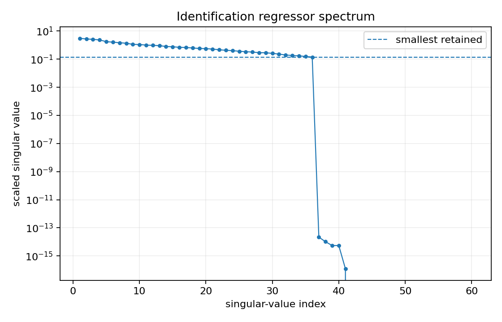
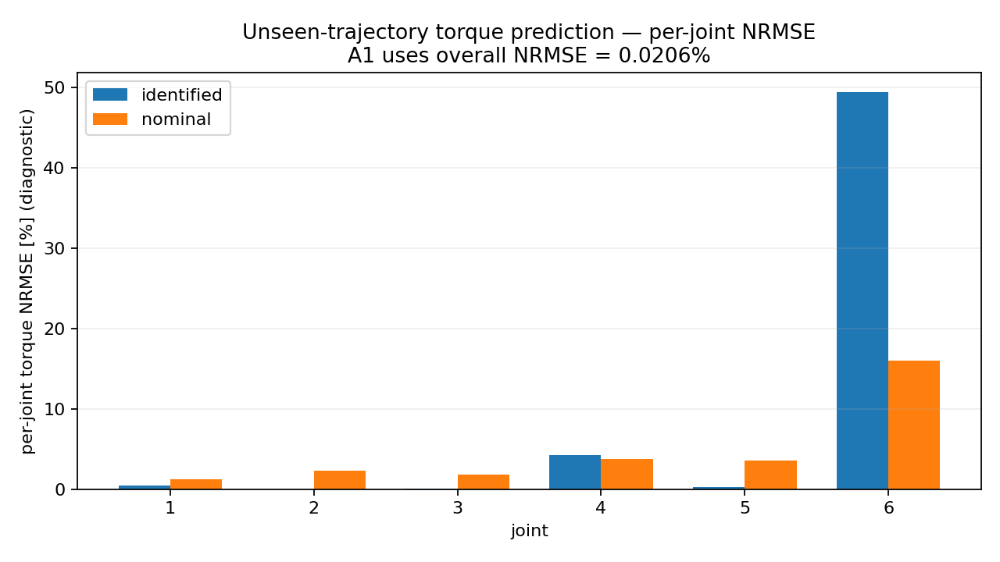
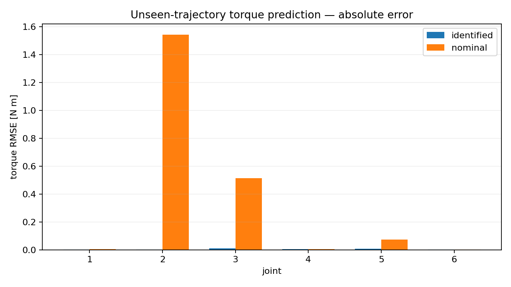
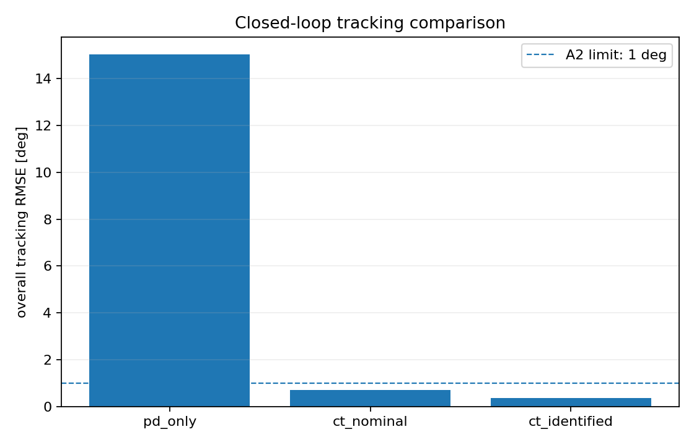

# 正式结果 — v1.0

状态：**MVP ACCEPTED**  
正式验收日期：2026-09-10

本页记录 v1.0.0 由 C++/Pinocchio 4.1.0 正式执行得到的技术结果。v1.0 不改变 v0.4 的算法/阈值，但修复 FR-05 机器可读 overall 输出并完成验收方扩展测试。

## 1. 结论

冻结的 A0/A1/A2 三项全部通过：

| 验收项 | 正式结果 | 条件 | 结论 |
|---|---:|---:|---|
| A0 `RNEA == Y*pi_true` | `4.3648e-16` worst relative error | `< 1e-10` | PASS |
| A1 未见轨迹 torque overall NRMSE | `0.02058 %` | `< 5 %` | PASS |
| A2 CT identified overall tracking RMSE | `0.36213 deg` | `< 1 deg` 且 `< CT nominal` | PASS |
| A2 CT nominal overall tracking RMSE | `0.70088 deg` | comparison baseline | — |

因此按照 `docs/REQUIREMENTS.md` 的 Definition of Done，**算法 MVP 到此停止，不再加入摩擦、滤波、在线辨识、ROS 等 backlog 功能。**

## 2. 正式实验配置

- 机器人：固定基座 6R `AeroArm6`；
- full inertial parameters：60；
- identification torque noise：`sigma = 0.20 N·m`；
- deterministic seed：`20260910`；
- identification samples：3591；
- stacked regressor：`21546 x 60`；
- scaled truncated-SVD relative threshold：`1e-8`；
- validation：18 s / 0.01 s；
- control：15 s / 0.001 s；
- CTC：`Kp=64`, `Kd=16`；
- PD：`Kp=95`, `Kd=18`。

## 3. A0 — 动力学回归一致性

100 个固定随机状态上：

```text
worst ||tau_RNEA - Y*pi_true|| / ||tau_RNEA||
= 4.36482362338e-16
```

这说明：

1. `toDynamicParameters()` 参数排列与项目回归矩阵使用一致；
2. tinyxml2 -> Pinocchio model construction 没有破坏 RNEA/regressor 的线性恒等关系；
3. 后续辨识误差不是由参数顺序或 API 接线错误造成。

额外的 `model_contract` 测试还独立核对了 URDF 的关节限位、effort/velocity limits，以及由 COM 惯量经平行轴定理得到的 60 维 dynamic parameters。

## 4. 参数可辨识性

scaled regressor 的结果：

```text
numerical rank = 36 / 60
retained condition number = 21.7029
```

因此 full 60-vector 存在明显结构冗余。奇异值在第 36 个 retained direction 之后下降到约 `1e-14` 量级并进入数值零空间。

这正是为什么本项目**不以 `theta_hat` 与 `theta_true` 逐项相等作为验收条件**。例如 `parameters.csv` 中某些 individual inertial parameters 看起来与真值相差很大，但它们可以位于等效参数集合中；真正需要评价的是：

```text
Y(q,dq,ddq) * theta_hat
```

能否在未见轨迹上预测真实关节力矩，以及能否在闭环中产生有效补偿。



## 5. 训练误差

训练数据加入 `0.20 N·m` 标准差的确定性高斯力矩噪声，最终：

```text
training RMSE = 0.2004 N·m
```

训练残差基本落在注入噪声尺度上。这是一个有用的 sanity check：模型没有出现明显系统性拟合偏差，同时也没有通过人为降低噪声来获得漂亮结果。

## 6. A1 — 未见轨迹力矩预测

### Overall

```text
identified overall RMSE = 0.00609813 N·m
identified overall NRMSE = 0.0205784 %

nominal overall RMSE = 0.665344 N·m
nominal overall NRMSE = 2.24523 %
```

辨识模型相对参数失配 nominal model 的 overall absolute torque RMSE 下降约 **99.08%**。

`validation_metrics.csv` v1.0 现在以同一 schema 保存 6 个关节行，并追加：

```text
overall,0.00609812684197,0.000205783809114,0.665344221955,0.0224523155903
```

该修复使 FR-05 的逐关节与 overall 指标都可由机器直接读取，而不再依赖 console 或人工报告。

### Per-joint diagnostic

| Joint | Identified RMSE (N·m) | Identified NRMSE | Nominal RMSE (N·m) | Nominal NRMSE |
|---:|---:|---:|---:|---:|
| 1 | 0.001953 | 0.447% | 0.005341 | 1.222% |
| 2 | 0.002781 | 0.00417% | 1.544963 | 2.317% |
| 3 | 0.011130 | 0.03893% | 0.513423 | 1.796% |
| 4 | 0.005868 | 4.205% | 0.005287 | 3.788% |
| 5 | 0.006563 | 0.3137% | 0.074332 | 3.553% |
| 6 | 0.003192 | 49.344% | 0.001035 | 16.000% |

Joint 6 的百分比需要结合绝对量解释：其 validation truth torque RMS 只有约 `0.00647 N·m`，因此几毫牛米的绝对误差会被很小的分母放大成很高 NRMSE。A1 的冻结验收定义是 **overall NRMSE**，不是“每个关节均 < 5%”。因此报告中同时保留 absolute RMSE 与 normalized RMSE，避免单看百分比得出错误结论。





## 7. A2 — Computed-Torque 闭环

正式 1 ms ABA plant 仿真：

| Controller | Overall RMSE | Max abs error | Saturation | Peak effort ratio | Min joint-limit margin | Peak velocity ratio |
|---|---:|---:|---:|---:|---:|---:|
| PD only | 15.0249 deg | 48.9435 deg | 0% | 0.5713 | 1.6883 rad | 0.9235 |
| CT nominal | 0.70088 deg | 4.6425 deg | 0% | 0.4372 | 1.7966 rad | 0.1815 |
| CT identified | **0.36213 deg** | 4.6442 deg | 0% | 0.4388 | 1.8134 rad | 0.1809 |

CT identified 相对 CT nominal 的 overall tracking RMSE 下降约 **48.33%**，并满足 `< 1 deg` 的冻结阈值。

此外：

- 三组控制均无 torque saturation；
- 无 joint position limit violation；
- 无 joint velocity limit violation。

因此 A2 的改善不是由饱和器、越限或异常状态“碰巧裁出来”的。



## 8. 项目最终回答了什么

该 MVP 已经用正式 C++/Pinocchio 结果回答了最初的三个问题：

1. **能否从带噪运动/力矩数据辨识出可用动力学模型？** 可以。训练残差与噪声尺度一致，未见轨迹 overall torque NRMSE 为 `0.02058%`。
2. **辨识模型能否修正 nominal model 的动力学误差？** 可以。未见轨迹 overall torque RMSE 从 `0.6653 N·m` 降到 `0.00610 N·m`。
3. **辨识模型能否改善模型补偿控制？** 可以。CTC overall tracking RMSE 从 nominal 的 `0.7009 deg` 降至 `0.3621 deg`。

## 9. 不应过度宣称的内容

本结果只证明当前**合成 rigid-body plant + 解析 q/dq/ddq + torque noise**条件下的辨识/控制闭环。它不证明：

- 实物机械臂上能达到同样误差；
- 已处理摩擦、齿隙、柔性、温漂和传感器偏置；
- full 60 个惯性参数均具有独立物理可辨识性；
- joint 6 的 relative torque prediction 已足够用于所有低力矩工况。

这些都属于后续独立项目，而不是本 MVP 的隐藏延伸项。
